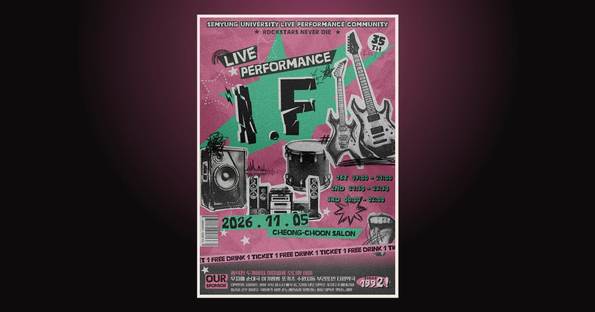
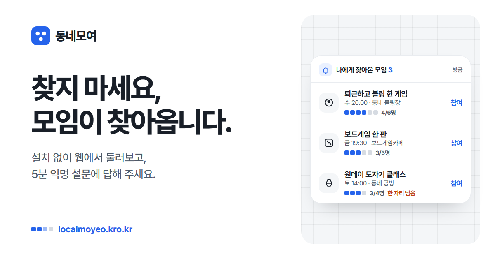

<h1 align="center">Hi, I'm Soo 👋</h1>

  AI research student at <b>Semyung University</b>, South Korea 
  Vision-Language Models · Computer Vision · Multimodal Learning 
  I write papers, and I build things people actually use.

  
  
  
  
  
  

---

### ⚡ At a Glance

| 📝 Research | 🏆 Awards | 🚀 Shipped |
|:-:|:-:|:-:|
| **8** papers, **6** as 1st author ACCV · KCC · KSC · KDBC · IEIE · KMMS | Hackathon **1st place** KCC paper **award** | **128** tickets sold online 모두의 창업 **Round 1** |

✍️ **Now:** writing **6 papers for CVPR**

### 📝 Publications

| | Venue | Authorship |
|:-:|---|---|
| 🌏 | **ACCV**: Asian Conference on Computer Vision | 1st author |
| 🏆 | **KCC**: Korea Computer Congress (KIISE) | 1st author · **Award** |
| 📄 | **KSC**: Korea Software Congress (KIISE) | 2 papers: 1st author, 2nd author |
| 📄 | **KDBC**: Korea Database Conference | 2 papers: 1st author, 2nd author |
| 📄 | **IEIE**: IEIE Conference | 1st author |
| 📄 | **KMMS**: Korea Multimedia Society Conference (Jeju National Univ.) | 1st author |

### 🏆 Awards & Honors

- 🥇 **1st Place**, Semyung University Hackathon
- 🏆 **Award**, KCC (Korea Computer Congress)
- 🚀 **Round 1**, 모두의 창업 national startup program, with 동네모여

### 🛠️ Projects

<table>
<tr>
<td width="50%" valign="top">

<h4>🎸 I.F 2026 LIVE: concert site &amp; ticketing</h4>
Promo site and end-to-end ticketing for Semyung University's live music club: online booking, bank-transfer matching, QR tickets and door check-in, self-hosted on one PC.
  
<b>890</b> unique visitors · <b>128</b> tickets sold online (<b>₩704,000</b>) · <b>108</b> QR check-ins
  
<code>Python</code> <code>Caddy</code> <code>GSAP</code> · <a href="https://ifband.kro.kr">site</a>
</td>
<td width="50%" valign="top">

<h4>🏘️ 동네모여 (Local Moyeo)</h4>
A meetup app for small cities. You set your interests and free time; when three or more people match, the app sets up the meetup at a local shop.
  
🚀 <b>Round 1</b>, 모두의 창업 national startup program
  
<code>Flutter</code> <code>Web</code> · <a href="https://localmoyeo.kro.kr">site</a> · <a href="https://github.com/gyeomsSoo/localmoyeo">repo</a> · <a href="https://github.com/gyeomsSoo/moyeo-boss">shop-owner survey</a>
</td>
</tr>
</table>

### 🔬 Research Interests

- **Vision-Language Models**: multimodal understanding with large VLMs
- **Image Segmentation**: Transformer-based dense prediction

### 📫 Contact

---

  <picture>
    <source media="(prefers-color-scheme: dark)" srcset="https://raw.githubusercontent.com/gyeomsSoo/gyeomsSoo/output/github-snake-dark.svg">
    <source media="(prefers-color-scheme: light)" srcset="https://raw.githubusercontent.com/gyeomsSoo/gyeomsSoo/output/github-snake.svg">
    
  </picture>

